<div align="right">

[](./README.md)

</div>

# Voice Transcript

Transcribes lectures and seminar recordings longer than an hour with Groq's hosted Whisper API:
it splits the audio at silences, transcribes the pieces, and stitches them back together. A
terminal CLI and a macOS / Windows / Linux desktop app share one engine, and history, the custom
dictionary and notes live in PostgreSQL on a home server, so every machine sees the same data.

<p align="center">
  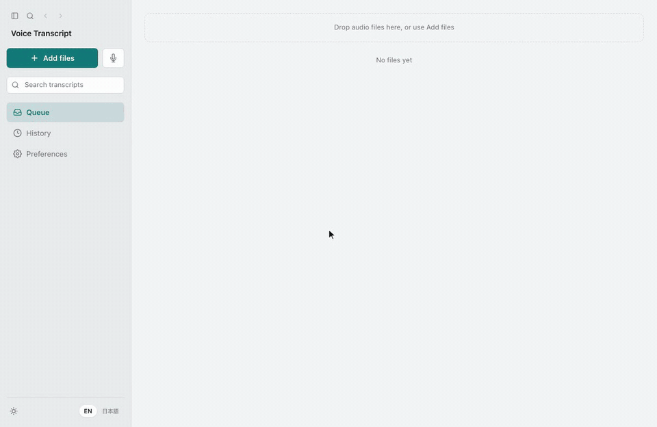
</p>

[Latest release](https://github.com/terasaki-8910/voice-transcript/releases/latest)
(.dmg / .exe / .msi / .AppImage / .deb) · [Spec: SPEC.md](./SPEC.md) · [Acceptance criteria: ACCEPTANCE.md](./ACCEPTANCE.md)

## Why

- I used Amical, a free transcription app, but it capped recording length and could not sync its
  dictionary or history between computers.
- Word's transcription often turned speech into entirely different words. I wanted the more
  accurate Whisper large-v3 models.
- With a recording of each lab seminar I can sort out tasks without missing anything, and I also
  wanted transcripts of lecture videos.

## Features

The app screenshots render the real frontend against a mocked backend with demo data. The CLI
image is a real run (17 s of speech synthesized with `say`).

### Long-audio transcription

Queued files are processed one at a time, each showing its state (queued, transcribing, done,
failed). One failure never stops the rest, and a failed file can be retried. The CLI handles one
file at a time with the same engine and produces the same text. Optionally, stretches of complete silence can be cut before upload so less audio counts against Groq's hourly limit; timestamps still match the original recording.

<p>
  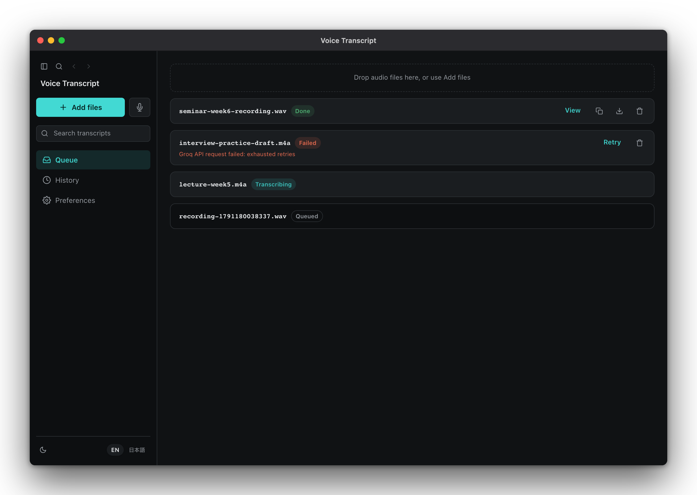
  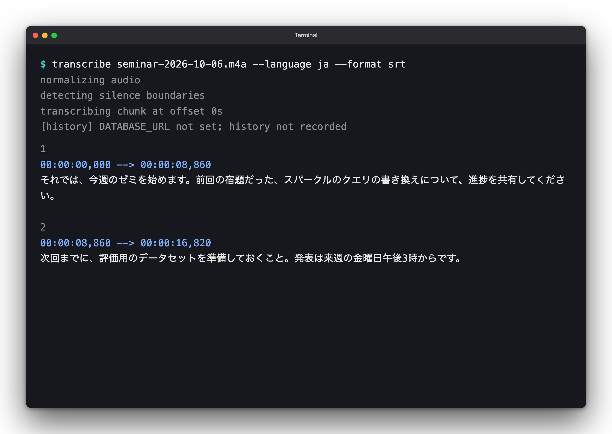
</p>

### Recording (microphone, system audio, or both)

No length limit. A live level meter shows that sound is coming in, and the source or device can be
switched without stopping. For lecture videos, recording can stop by itself after a stretch of
silence. Once a recording is transcribed successfully, its audio file goes to the OS trash.

<p>
  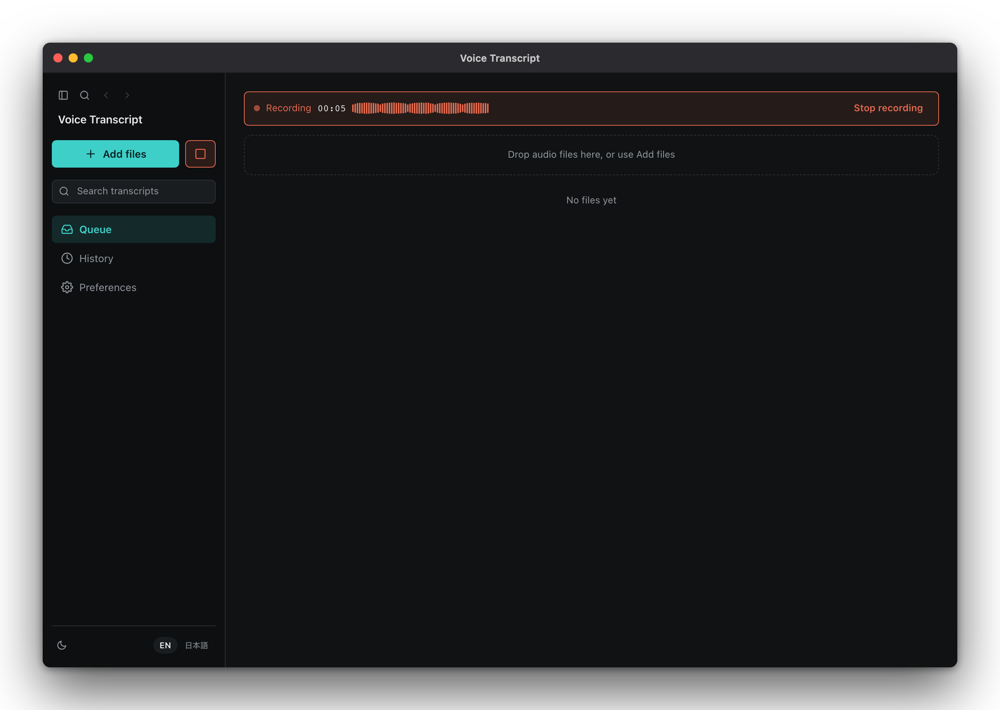
  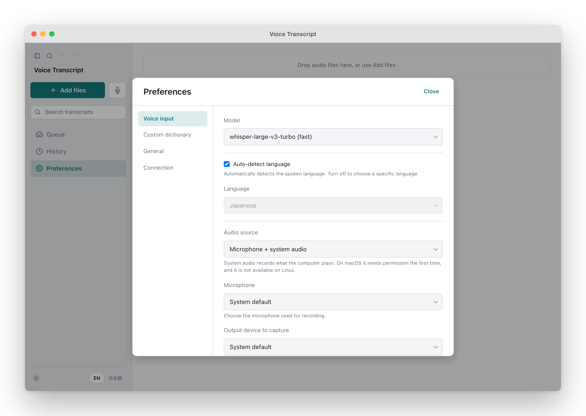
</p>

### Notes and the custom dictionary

Attach a note to a selected passage without editing the transcript itself (for example, "2GOMCP"
noted as a mis-hearing of TogoMCP). A note can become a dictionary entry, which fixes every
transcription from then on. The "スパークル" in the CLI output above is a mis-heard "SPARQL" that
a dictionary entry would correct.

<p>
  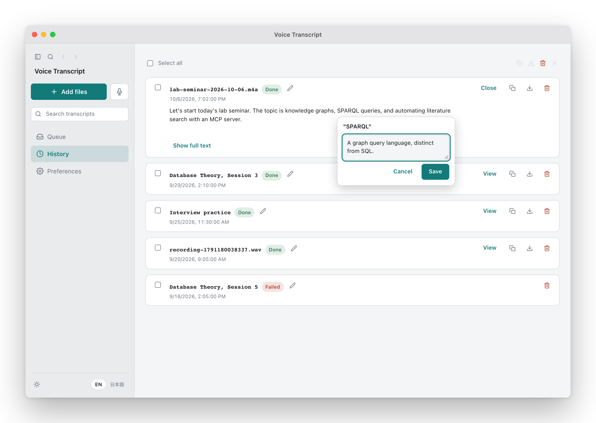
  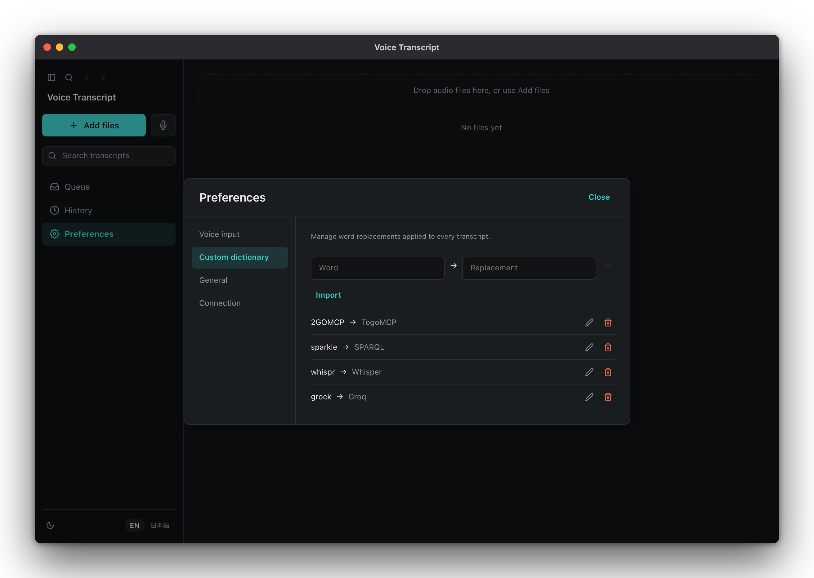
</p>

### History and search

Every run, from the CLI or the app, is saved to PostgreSQL. Cmd+F / Ctrl+F searches titles,
transcripts and notes across the whole history, with space-separated AND terms. History entries
can be renamed, range-selected with Shift+click for bulk actions, copied with or without notes,
and exported as txt / srt / vtt / json.

<p>
  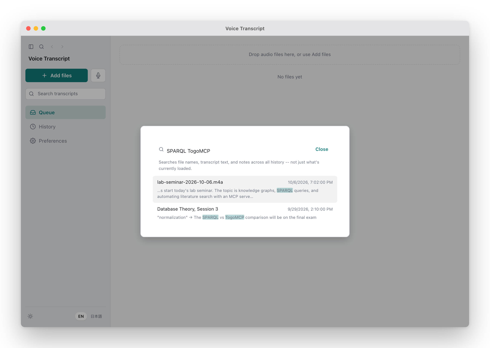
  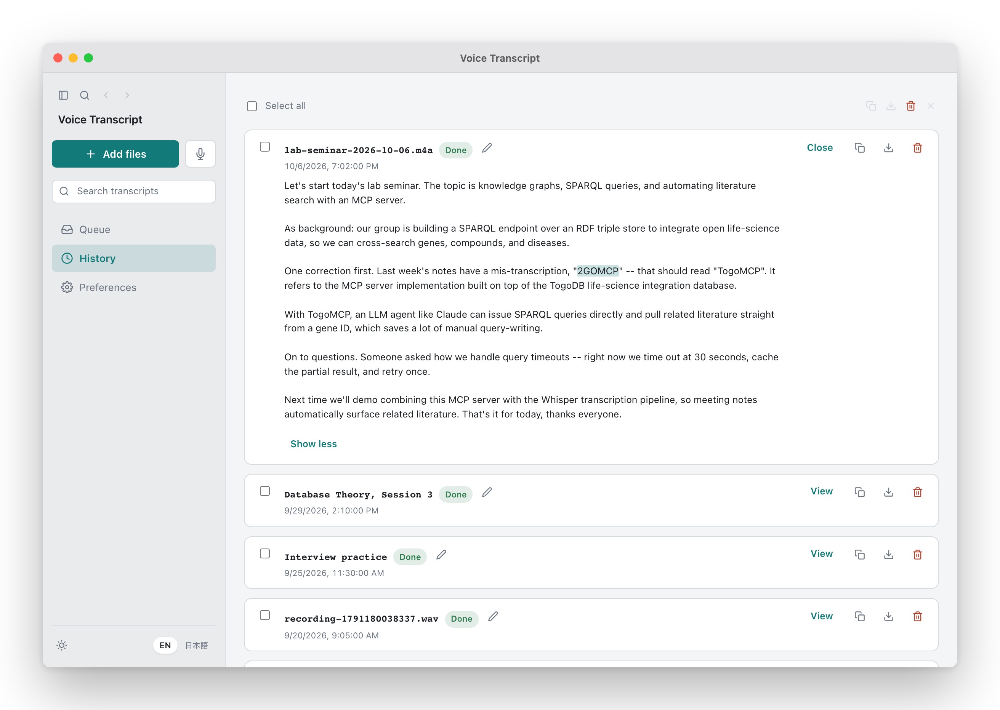
</p>

### Settings and connection test

The API key and database URL can be set from the GUI, and a button checks whether the saved
database is reachable right now. A failure shows the real error (timeout, authentication failure)
instead of a generic message. Light/dark and Japanese/English switch without a restart.

<p>
  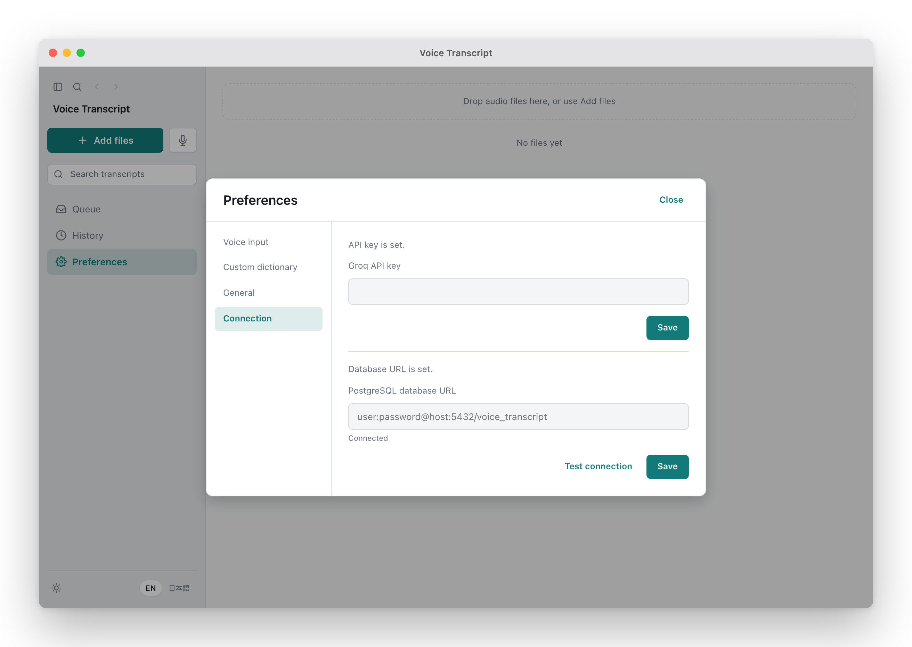
  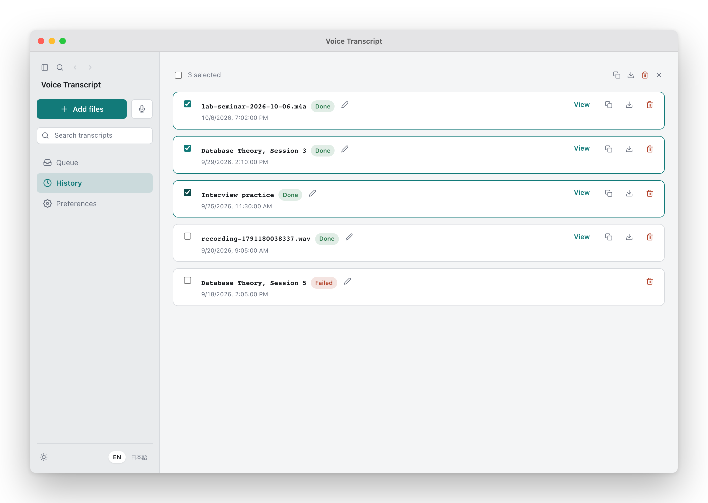
</p>

## Architecture

<picture>
  <source media="(prefers-color-scheme: dark)" srcset="docs/diagrams/architecture-dark.png">
  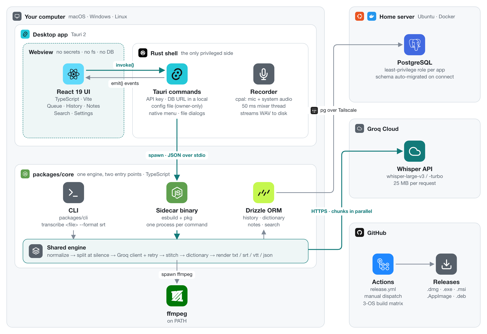
</picture>

- **One engine, two entry points.** All transcription logic lives in `packages/core`
  (TypeScript). The CLI calls it directly; the desktop app runs the same code packaged as a
  single-binary sidecar. The same file with the same settings gives the same text either way.
- **Only the Rust side is privileged.** The webview never touches the API key, the filesystem or
  the database. ffmpeg, the Groq API and the database are reached through Rust commands, and Rust
  writes no SQL itself; it spawns the sidecar. Rust stores the API key and database URL in the
  OS config directory with owner-only permissions, and the webview can only read whether each is
  set.
- **The sidecar starts and exits per command.** It holds no state, so one failure never leaks into
  the next call. The cost is a few hundred ms of startup, so notes are applied optimistically and
  saved in the background, search is debounced by 250 ms, and the history list fetches note
  counts with a single JOIN.
- **Data stays on a home server.** PostgreSQL runs in Docker on Ubuntu and is reached over
  Tailscale, with a least-privilege role for this app; the app migrates the schema on connect.
  If the database is unreachable, transcription still finishes; only the history write fails, and
  it is logged.

## Long-audio pipeline

<picture>
  <source media="(prefers-color-scheme: dark)" srcset="docs/diagrams/pipeline-dark.png">
  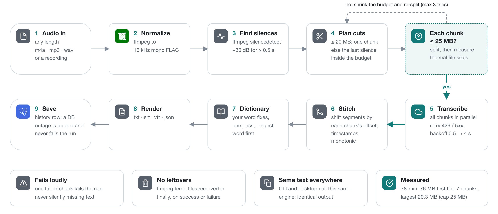
</picture>

Groq's free tier accepts 25 MB per request. Audio that is still larger after ffmpeg normalizes it
to 16 kHz mono is cut at silences with a 20 MB target. After splitting, the real file sizes are
measured; if any chunk is over 25,000,000 bytes, the target shrinks and the audio is split again
(up to 3 times). Estimating from the average bitrate alone can overshoot the cap by a few percent,
which caused 413 errors in real use. Chunks are sent in parallel, and each chunk's timestamps are
shifted by its start offset when stitching.

## Recording

<picture>
  <source media="(prefers-color-scheme: dark)" srcset="docs/diagrams/recording-dark.png">
  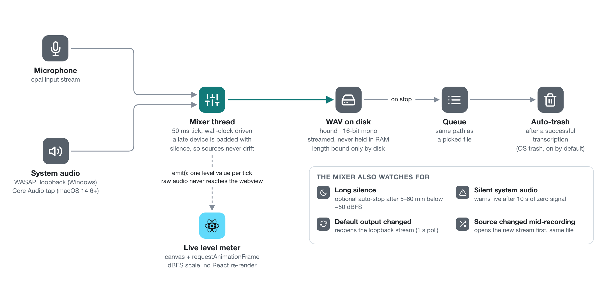
</picture>

Recording uses Rust's `cpal`, not a browser API: no released Tauri version lets the Linux webview
capture the microphone, and native capture behaves the same on all three platforms. The mixer
writes against the wall clock and pads a late device with silence, so two sources never drift
apart over a long recording. The webview receives one level value per tick, never the audio
itself.

## Tech stack

<picture>
  <source media="(prefers-color-scheme: dark)" srcset="docs/diagrams/stack-dark.png">
  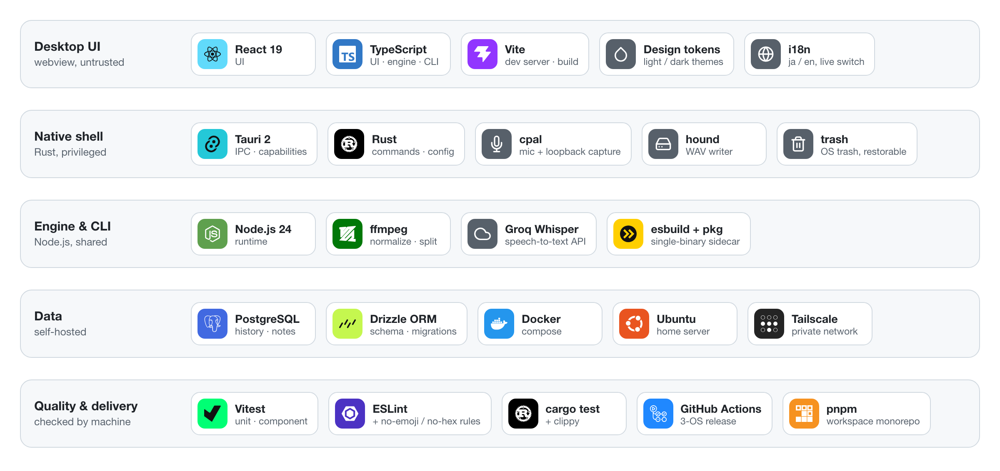
</picture>

## Usage

### Desktop app

Install the package for your OS from
[Releases](https://github.com/terasaki-8910/voice-transcript/releases/latest) and enter your Groq
API key under Settings > Connection. For history, dictionary, notes and search, also enter a
PostgreSQL connection string (you provide the database). ffmpeg must be on `PATH`.

If macOS says the app "is damaged and can't be opened": releases are not signed or notarized by
Apple, so Gatekeeper blocks the quarantined download. After moving the app to `/Applications`,
clear the attribute:

```sh
xattr -cr "/Applications/Voice Transcript.app"
```

### CLI

Requires Node.js 24, pnpm and ffmpeg. The CLI is not part of the release; run it from source.

```sh
pnpm install
export GROQ_API_KEY=...
export DATABASE_URL=postgresql://...   # optional: history and dictionary
# pnpm runs the script inside the package directory, so pass absolute paths
pnpm --filter @voice-transcript/cli transcribe "$PWD/lecture.m4a" --format srt -o "$PWD/lecture.srt"
```

| Option | Description | Default |
|---|---|---|
| `-o, --output <file>` | Write to a file (logs go to stderr only) | stdout |
| `--format <txt\|srt\|vtt\|json>` | Output format | `txt` |
| `--model <name>` | `whisper-large-v3-turbo` / `whisper-large-v3` | `whisper-large-v3-turbo` |
| `--language <code>` | Pin the spoken language | auto-detect |
| `--trim-silence` | Remove stretches of complete silence (2 s or longer, below -60 dBFS) before sending; timestamps stay on the original timeline | off |

## Development

```sh
pnpm install
pnpm --filter desktop tauri dev   # desktop dev loop
pnpm -r test                      # core 138 / cli 23 / desktop 323 tests
pnpm -r lint && pnpm -r typecheck
cd apps/desktop/src-tauri && cargo test && cargo clippy   # 45 Rust tests
```

ESLint carries custom rules that ban emoji and hard-coded hex colors; colors come only from design
tokens. Releases run from a manually dispatched GitHub Actions workflow, `release.yml`, which
uploads installers for all three platforms to a GitHub Release.

Built with Claude Code. The spec lives in `SPEC.md` and the pass/fail criteria in
`ACCEPTANCE.md`; "done" was decided by tests, lint and type checks. The diagrams are generated by
the scripts in `docs/diagrams/src/`.

## Limits and non-goals

- Runs within Groq's free tier (25 MB per request, 7,200 audio seconds per hour, 2,000 requests
  per day).
- System audio cannot be recorded on Linux (ALSA has no loopback).
- The API key and database URL are stored in plain text in an owner-only local file, not the OS
  keychain. That is a deliberate call for a single-user tool; revisit it before using a shared
  machine.
- No speaker diarization, translation, summarization, real-time transcription, URL input or
  multiple users. Several computers simply point at the same database, with no conflict
  resolution (last write wins).

## License

[MIT](./LICENSE)
