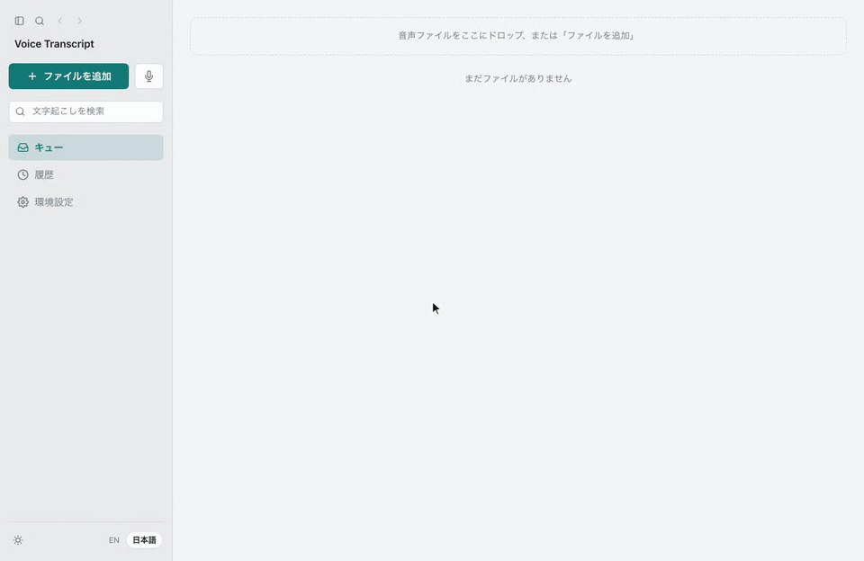
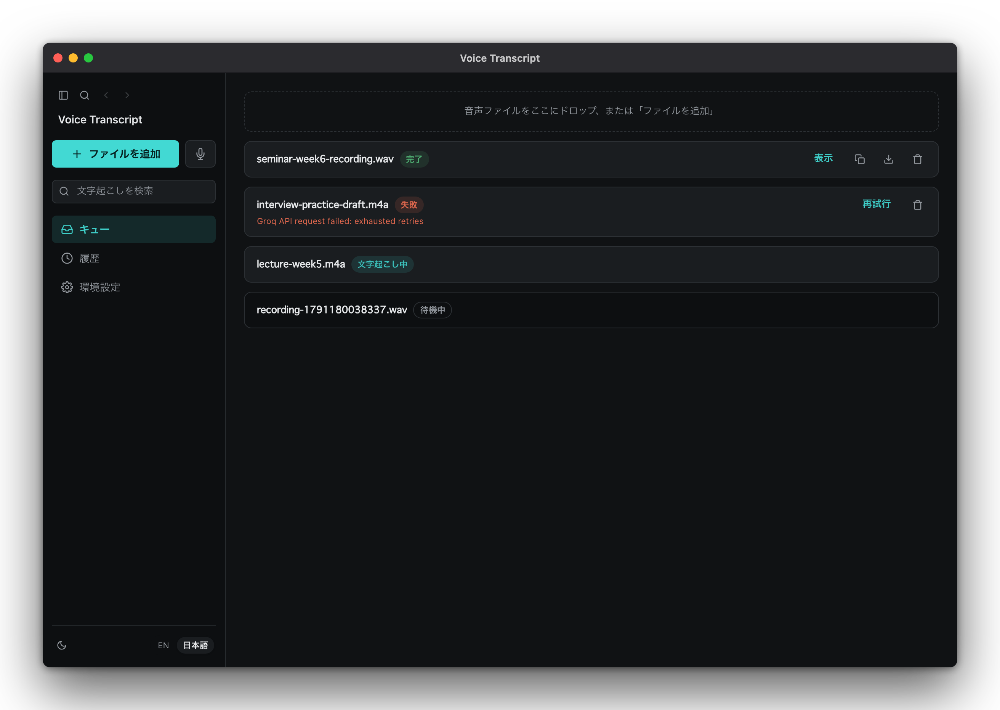
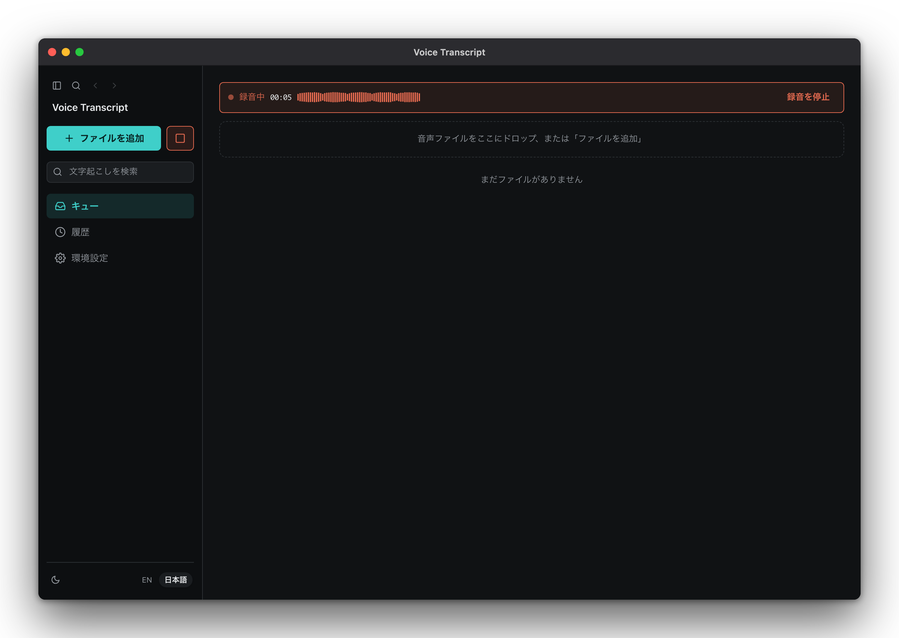
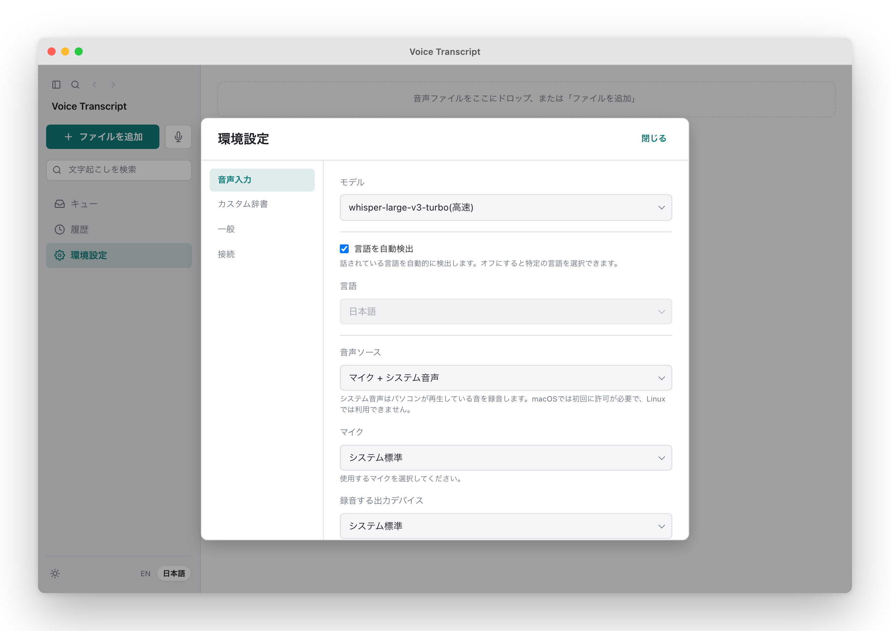
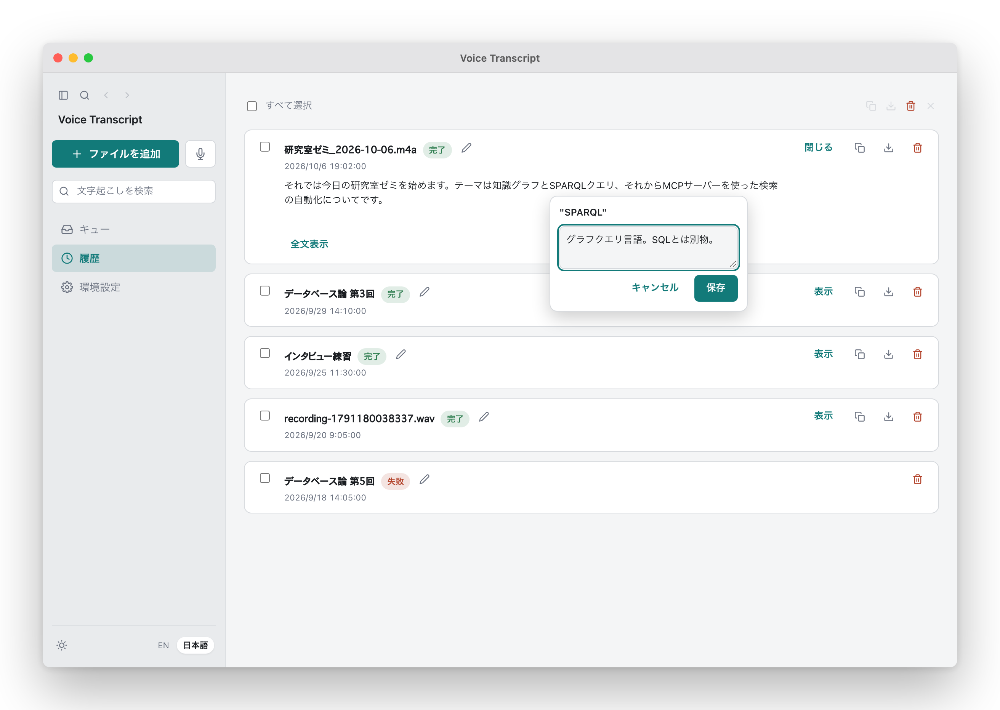
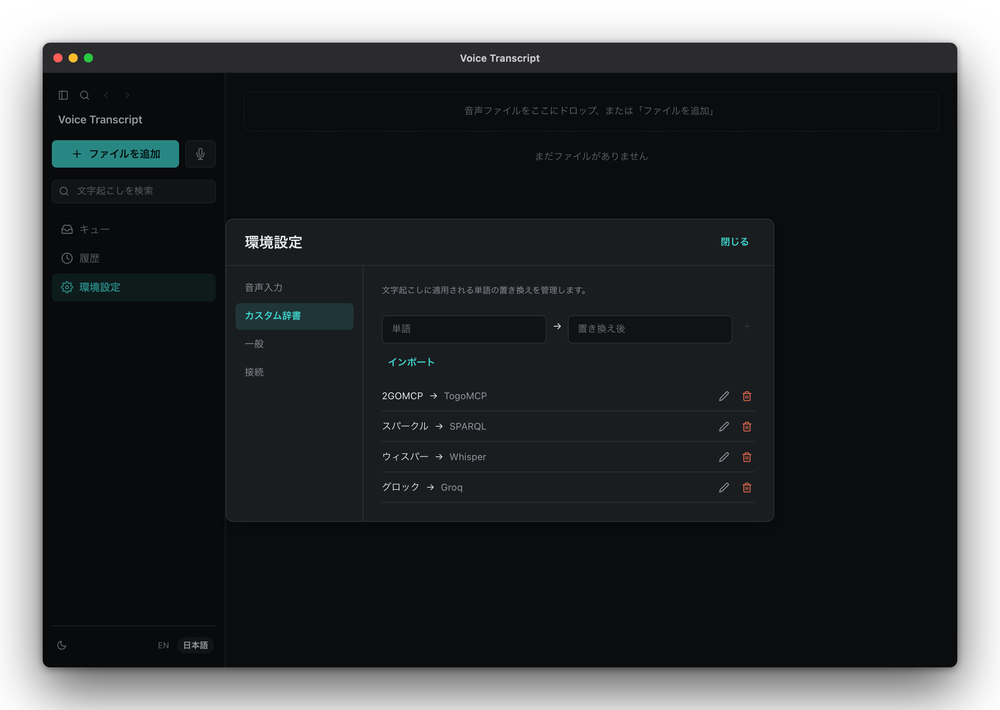
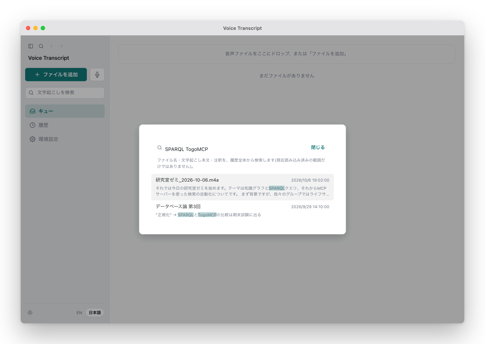
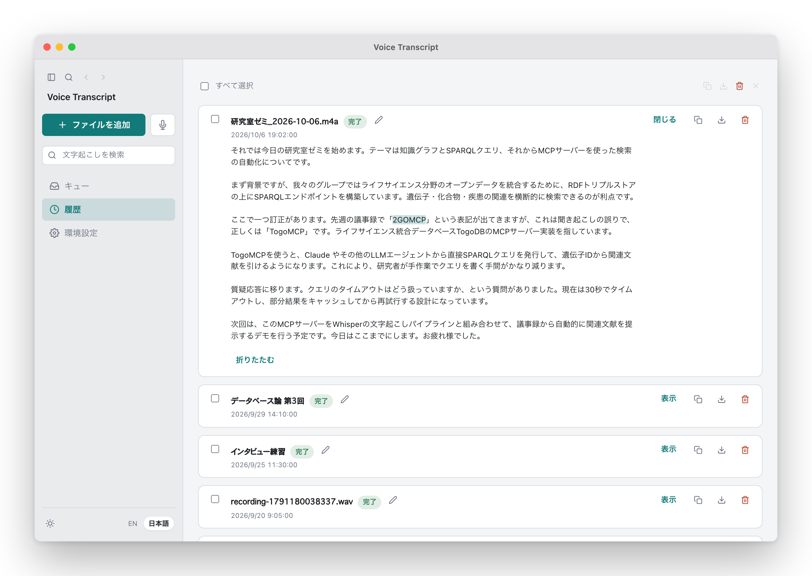
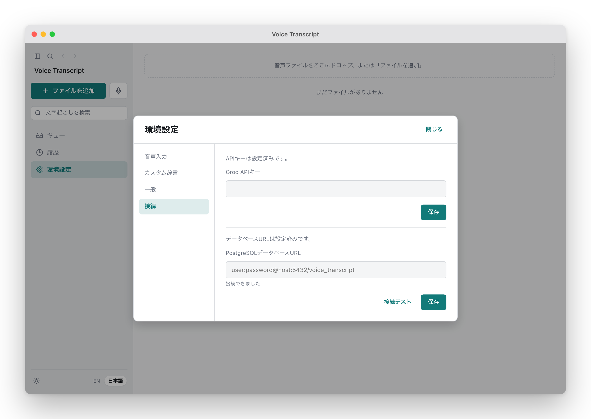
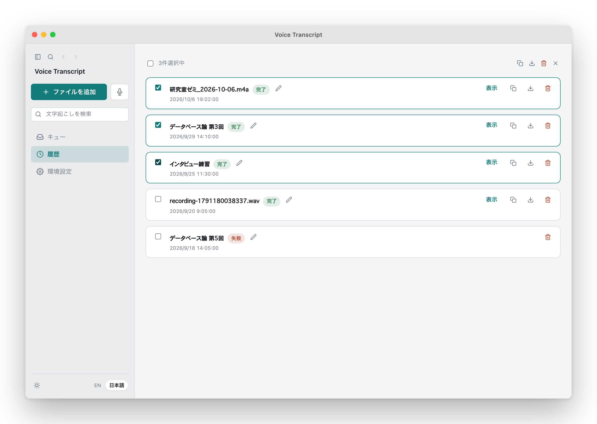

<div align="right">

[](./README.en.md)

</div>

# Voice Transcript

1 時間を超える講義やゼミの録音を、無音の位置で分割して Groq の Whisper API で文字起こしし、つなぎ直すツール。ターミナルの CLI と macOS / Windows / Linux のデスクトップアプリが同じエンジンを共有し、履歴・カスタム辞書・注釈は自宅サーバの PostgreSQL に保存して複数の PC から同じデータを使う。

<p align="center">
  
</p>

[最新リリース](https://github.com/terasaki-8910/voice-transcript/releases/latest)（.dmg / .exe / .msi / .AppImage / .deb）・[仕様 SPEC.md](./SPEC.md)・[受け入れ基準 ACCEPTANCE.md](./ACCEPTANCE.md)

## 背景

- 無料の文字起こしアプリ Amical を使っていたが、録音の時間制限があり、辞書と履歴を PC 間で同期できなかった。
- Word のトランスクリプト機能は、まったく別の言葉に変換されることが多かった。精度の高い Whisper large-v3 系モデルに切り替えたかった。
- 研究室のゼミを録音しておけば、聞き逃しなくタスクを整理できる。授業動画の文字起こしにも使いたかった。

## 主な機能

画面写真は実際のフロントエンドを、バックエンドをモックしたデモデータで描画したもの。CLI の画像は実際の実行結果（`say` で合成した 17 秒の音声）。

### 長時間音声の文字起こし

複数ファイルをキューに積むと、1 件ずつ順に処理し、ファイルごとに状態（待機・文字起こし中・完了・失敗）を表示する。1 件が失敗してもほかは止まらず、失敗したものは再試行できる。CLI は 1 ファイルずつ、同じエンジンで同じテキストを出す。

<p>
  
  
</p>

### 録音（マイク / システム音声 / 両方）

時間の上限はない。録音中もレベルメーターで音が入っているか確認でき、音源やデバイスを止めずに切り替えられる。授業動画の終わりを想定して、無音が続いたら自動で停止できる。文字起こしが成功した録音ファイルは自動で OS のゴミ箱へ移す。

<p>
  
  
</p>

### 注釈とカスタム辞書

文字起こしの本文は書き換えずに、選択した箇所へ注釈を付ける（例:「2GOMCP」に「TogoMCP の聞き間違い」）。注釈はそのまま辞書に登録でき、次の文字起こしから自動で置換される。上の CLI の出力で「スパークル」となっている SPARQL も、辞書に入れておけば直る。

<p>
  
  
</p>

### 履歴と横断検索

CLI とアプリのすべての実行を PostgreSQL に保存する。Cmd+F / Ctrl+F の検索は、タイトル・本文・注釈を全履歴から AND 検索する。履歴は名前の変更、Shift+クリックでの範囲選択と一括操作、本文のみ／注釈付きのコピー、txt / srt / vtt / json への書き出しに対応する。

<p>
  
  
</p>

### 設定と接続テスト

API キーとデータベース URL は GUI から設定でき、保存した接続先に今つながるかを試せる。失敗したときは定型文ではなく実際のエラー（タイムアウト、認証失敗など）を表示する。ライト／ダーク、日本語／英語を再起動なしで切り替えられる。

<p>
  
  
</p>

## アーキテクチャ

<picture>
  <source media="(prefers-color-scheme: dark)" srcset="docs/diagrams/architecture-dark.png">
  
</picture>

- **1 つのエンジン、2 つの入口。** 文字起こしの処理はすべて `packages/core`（TypeScript）にあり、CLI はこれを直接呼び、デスクトップアプリは同じコードを 1 つの実行ファイルにまとめたサイドカーとして呼ぶ。同じファイルを同じ設定で処理すれば、どちらからでも同じテキストになる。
- **特権のある処理は Rust 側だけ。** 画面（webview）は API キー、ファイルシステム、DB に触れない。ffmpeg、Groq API、DB へのアクセスは Rust のコマンドを経由し、Rust は自分では SQL を書かずにサイドカーを起動する。API キーと DB の URL は Rust が OS の設定フォルダに所有者のみ読める権限で保存し、画面からは「設定済みかどうか」しか読めない。
- **サイドカーはコマンドごとに起動して終わる。** 状態を持たないので、1 回の失敗が次に残らない。代わりに起動の遅れ（数百 ms）があるため、注釈は楽観的に即反映して裏で保存し、検索は 250 ms のデバウンスをかけ、履歴一覧は注釈の件数を JOIN でまとめて取る。
- **データは自宅サーバに置く。** Ubuntu の Docker で動かす PostgreSQL に Tailscale 経由で接続する。アプリ専用の最小権限ロールを使い、スキーマは接続時に自動でマイグレーションする。DB に届かなくても文字起こしは止めない（履歴の記録だけ失敗をログに出す）。

## 長時間音声の処理

<picture>
  <source media="(prefers-color-scheme: dark)" srcset="docs/diagrams/pipeline-dark.png">
  
</picture>

Groq の無料枠は 1 リクエスト 25 MB まで。ffmpeg で 16 kHz モノラルに正規化してもこれを超える音声は、20 MB を目安に無音の位置で区切る。分割後は実際のファイルサイズを測り、25,000,000 バイトを超えるチャンクがあれば目安を縮めて分割し直す（最大 3 回）。平均ビットレートからの見積もりだけでは上限を数 % 超えることがあり、実運用で 413 エラーが出たためこの方式にした。チャンクは並列に送り、各チャンクの開始位置だけタイムスタンプをずらしてつなぐ。

## 録音の仕組み

<picture>
  <source media="(prefers-color-scheme: dark)" srcset="docs/diagrams/recording-dark.png">
  
</picture>

録音はブラウザの API ではなく Rust の `cpal` で行う。リリース済みの Tauri では Linux の webview からマイクを取れず、3 つの OS で同じ動きにするためにネイティブにした。ミキサーは実時間に合わせて書き出し、遅れたデバイスの分は無音で埋めるので、2 つの音源が長時間の録音でずれない。画面に送るのは 1 tick あたり 1 つの音量値だけで、音声そのものは送らない。

## 技術スタック

<picture>
  <source media="(prefers-color-scheme: dark)" srcset="docs/diagrams/stack-dark.png">
  
</picture>

## 使い方

### デスクトップアプリ

[Releases](https://github.com/terasaki-8910/voice-transcript/releases/latest) から OS に合ったインストーラを入れ、設定 > 接続 で Groq の API キーを入れる。履歴・辞書・注釈・検索を使う場合は PostgreSQL の接続文字列も入れる（DB 自体は自分で用意する）。ffmpeg が `PATH` 上に必要。

macOS で「壊れているため開けません」と出る場合: リリースは Apple の署名と公証をしていないため、ダウンロード時の quarantine 属性で Gatekeeper に止められる。`/Applications` に移したあと、次のコマンドで解除できる。

```sh
xattr -cr "/Applications/Voice Transcript.app"
```

### CLI

Node.js 24、pnpm、ffmpeg が必要。CLI はリリースに含めず、ソースから使う。

```sh
pnpm install
export GROQ_API_KEY=...
export DATABASE_URL=postgresql://...   # 任意。履歴と辞書を使う場合
# pnpm はパッケージのディレクトリで実行するので、パスは絶対パスで渡す
pnpm --filter @voice-transcript/cli transcribe "$PWD/lecture.m4a" --format srt -o "$PWD/lecture.srt"
```

| オプション | 説明 | 既定 |
|---|---|---|
| `-o, --output <file>` | ファイルに書き出す（ログは stderr のみ） | 標準出力 |
| `--format <txt\|srt\|vtt\|json>` | 出力形式 | `txt` |
| `--model <name>` | `whisper-large-v3-turbo` / `whisper-large-v3` | `whisper-large-v3-turbo` |
| `--language <code>` | 話す言語を固定する | 自動判定 |

## 開発

```sh
pnpm install
pnpm --filter desktop tauri dev   # デスクトップアプリの開発
pnpm -r test                      # core 95 / cli 18 / desktop 316 件
pnpm -r lint && pnpm -r typecheck
cd apps/desktop/src-tauri && cargo test && cargo clippy   # Rust 45 件
```

ESLint には絵文字とハードコードした色（hex）を禁止する独自ルールを入れ、色はデザイントークンだけで指定する。リリースは GitHub Actions の `release.yml` を手動で実行し、3 つの OS のインストーラを GitHub Release に上げる。

Claude Code を使って開発した。仕様は `SPEC.md`、合否の基準は `ACCEPTANCE.md` に書き、完了の判定はテスト・lint・型チェックで機械的に行った。図は `docs/diagrams/src/` のスクリプトから生成している。

## 制約と対象外

- Groq の無料枠（1 リクエスト 25 MB、1 時間あたり 7,200 音声秒、1 日 2,000 リクエスト）の範囲で動かす。
- Linux ではシステム音声を録音できない（ALSA にループバックがないため）。
- API キーと DB の URL は OS のキーチェーンではなく、所有者のみ読めるローカルファイルに平文で保存する。1 人で使う個人ツールとしての判断で、共有マシンで使うなら見直しが要る。
- 話者分離、翻訳、要約、リアルタイム文字起こし、URL 入力、複数ユーザーは対象外。複数の PC は同じ DB を指すだけで、競合の解決はしない（後勝ち）。

## ライセンス

[MIT](./LICENSE)
